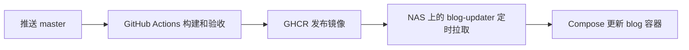

# 博客部署

## 当前发布流程



[发布工作流](../.github/workflows/blog-image.yml) 运行格式和 lint 检查、静态构建、迁移校验及容器 HTTP 验收。通过后发布 `ghcr.io/zhaopan-pan/blog:production` 和 `ghcr.io/zhaopan-pan/blog:sha-<完整提交 SHA>`，支持 `linux/amd64` 和 `linux/arm64`。`production` 跟随成功发布的版本，SHA 标签用于固定版本和回滚。工作流不连接 NAS。

博客镜像由仓库的 [Dockerfile](../Dockerfile) 打包，用 [Nginx](nginx.conf) 提供静态文件，不运行 Node.js。两个公网入口共用同一个 `blog` 容器；更新镜像不需要改域名、隧道或反代规则。

## NAS 上部署和自动更新

1. 在绿联 Docker 创建 `blog` 项目，使用 [compose.yaml](compose.yaml)，把 [update.sh](update.sh) 放在 NAS 上的 Compose 文件旁。保留本机绑定，不把博客的 HTTP 后端端口直接暴露到公网。`.env` 中不设置 `BLOG_TAG`，或设为 `production`；固定 `sha-...` 时不会跟随新版本。
2. 单独创建 `blog-updater` 项目，导入 [compose.updater.yaml](compose.updater.yaml)，不要覆盖 `blog`。如果博客项目名不同，修改 `COMPOSE_PROJECT_NAME`；如果目录不同，修改 `working_dir` 及博客目录挂载的两端。已在运行的更新器不需要重新部署。
3. 更新器运行 `update.sh`，每轮结束后等待 10 分钟。脚本只拉取和更新 `blog` 服务，镜像与配置都未变化时不会重建容器。启动后确认日志里博客容器到达 `Healthy`，并在下一轮看到新的时间戳。绿联 Docker 的全局「按计划更新」可关闭，「更新检测」可保留。不需要 Lucky 或宿主机 cron 来更新镜像。

更新器不开放端口，但挂载 `docker.sock` 等同于授予宿主机 Docker 管理权限。只运行可信镜像和脚本，限制部署目录的写权限。当前博客镜像可匿名拉取；若改为私有，须为更新器单独配置 GHCR 读取凭据，宿主机登录信息不会自动传入。

## 公网入口

### 正式入口：`https://zhaopan.me`

1. 在 [Cloudflare Tunnel](https://developers.cloudflare.com/tunnel/get-started/#publish-an-application) 添加公开应用路由，主机名为 `zhaopan.me`，服务类型选 HTTP，目标填 `cloudflared` 所在网络可访问的博客后端。
2. 由 Cloudflare 提供公网 HTTPS，`cloudflared` 主动建立出站隧道。此入口不依赖 Lucky，也不需要在路由器上开放博客后端端口。若 `cloudflared` 与 NAS 宿主机不共享网络，不能用连接器容器自身的 `localhost` 指向宿主机。
3. [站点配置](../packages/blog/cabin.config.mjs) 以此域名生成 canonical 和 sitemap。验收时从外网访问首页和文章深链，确认 HTTPS 正常且页面的 canonical 指向正式域名。

### 备用入口：`https://nas.zhaopan.site:10443`

1. 确保 `nas.zhaopan.site` 的公网 DNS 指向能到达 Lucky 的入口，并且公网可访问 TCP `10443`。如果用 DDNS，记录由 DDNS 保持更新；只放行这个博客 HTTPS 入口，不开放 NAS、Lucky 或 Docker 的管理接口。
2. 在 [Lucky 的 Web 服务](https://lucky666.cn/docs/modules/web/) 中配置 TLS 监听，使用覆盖 `nas.zhaopan.site` 的有效证书。添加该域名的反向代理规则，目标填 Lucky 所在网络可访问的同一个博客 HTTP 后端。不要把反代目标写成公网入口本身。
3. 从外网带 `:10443` 访问，确认 TLS 与文章深链正常。备用入口独立于 Cloudflare Tunnel，但与正式入口共用 NAS 和博客容器；它不是独立的故障切换站点，也不修改 canonical。

本文只记录公开入口和配置方式。不提交实际内网地址、管理地址、隧道标识与令牌、GHCR 凭据或证书私钥。

## 验收与回滚

`Pulled` 或 `Healthy` 只说明本轮执行成功，不代表版本发生变化。在 NAS 上用运行中容器的镜像查实际提交，与 GitHub Actions 发布的 SHA 比对（示例项目名为 `blog`）：

```sh
docker image inspect "$(docker inspect blog-blog-1 --format '{{.Image}}')" \
  --format '{{index .Config.Labels "org.opencontainers.image.revision"}}'
```

- 手动更新：在博客的 Compose 目录执行 `sh ./update.sh`。
- 回滚：保留上一个 SHA 标签，将同目录 `.env` 的 `BLOG_TAG` 改为 `sha-<完整提交 SHA>`，再执行相同脚本。改回 `production` 即恢复自动跟随。
- 从外网抽查两个入口的首页、旧中文 `.html` 深链、分类目录、HTTP 404、站点地图、中文搜索和压缩响应。若只有一个入口异常，优先检查该入口的代理配置和缓存；两个都异常时，先检查容器及已部署版本。

## 压缩

Astro/Vite 在构建时压缩 JS、CSS 等产物；容器内 Nginx 按请求对 HTML、CSS、JS、JSON、XML、SVG 等启用 gzip。经 Cloudflare Tunnel 访问时，Cloudflare 也可按边缘配置压缩到访客的响应。不在仓库中额外生成 `.gz` 文件。

## 不用 Docker：直接发布静态文件

1. 在仓库根目录运行 `pnpm build` 和 `pnpm verify:migration`，把 `packages/blog/dist/` **的内容**发布到域名根目录。服务端须支持原有 `.html` URL 和目录下的 `index.html`，不存在的路径返回 `404.html` 和 HTTP 404，不加 SPA fallback。
2. 保留根路径 `/service-worker.js`，用于注销旧 VuePress worker；`dist/pagefind/` 和静态文件一起发布，不需要在线建索引或运行 Node.js。
3. 发布前保留上一版完整产物和服务器配置。发布后按上面的清单验收；回滚时恢复完整产物和配置，有 CDN 缓存时按需清理。旧 VuePress、部署脚本和 Algolia 爬虫可从 Git 历史找回。
