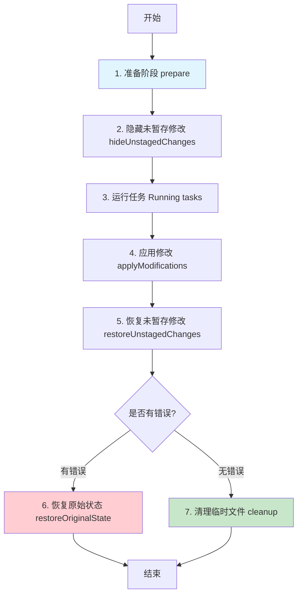
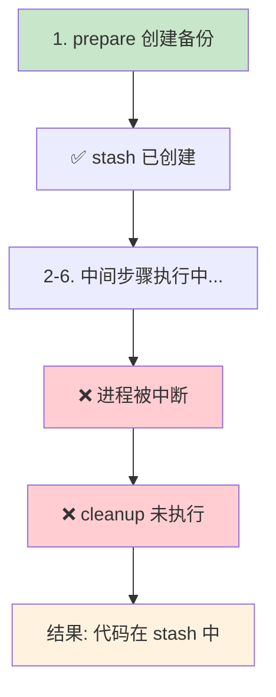

## 背景：一次"诡异"的代码丢失事件

"我的代码怎么不见了？！"，组里的小王突然跑过来问我。

他描述的情况是这样的：在执行 `git commit` 提交代码时，原本在暂存区的文件突然消失了，工作区的修改也不见了。正当他准备怀疑人生时，有同学提醒他查看 `git stash list`，果然，丢失的代码静静地躺在 stash 列表里。

这不是个例，组内已经有好几位同学遇到过类似的问题。代码为什么会"被吃掉"？今天我们就从源码角度深入剖析这个问题。

## lint-staged 的工作原理

### 核心机制：基于 GitWorkflow 的安全执行

lint-staged 的核心逻辑在 `GitWorkflow` 类中，它采用了一套精妙的备份恢复机制：

```javascript
// runAll.js - 主流程
export const runAll = async (options) => {
  // 关键：默认启用 stash 备份
  const ctx = { shouldBackup: hasInitialCommit && stash }
  
  const git = new GitWorkflow({ matchedFileChunks, topLevelDir })
  
  const runner = new Listr([
    { title: 'Backing up original state...', task: (ctx, task) => git.prepare(ctx, task) },
    { title: 'Running tasks...', task: () => runTasks() },
    { title: 'Applying modifications...', task: (ctx) => git.applyModifications(ctx) },
    { title: 'Cleaning up...', task: (ctx) => git.cleanup(ctx) },
  ])
}
```

### 完整执行流程图



### 关键步骤解析

#### 1. 准备阶段（prepare）- 创建备份

```javascript
// gitWorkflow.js
async prepare(ctx, task) {
  if (ctx.shouldBackup) {
    // 创建 stash 备份（关键！）
    const stashHash = await this.execGit(['stash', 'create'])
    ctx.backupHash = await this.execGit(['rev-parse', '--short', stashHash])
    await this.execGit([
      'stash', 'store', '--quiet', '--message',
      `${STASH} (${ctx.backupHash})`, ctx.backupHash,
    ])
    
    task.title = `Backed up original state in git stash (${ctx.backupHash})`
  }
}
```

**核心机制**：使用 `git stash create` + `git stash store` 而非 `git stash push`，避免改变工作区状态。

#### 2. 运行任务阶段 - 执行 linter

这个阶段执行用户配置的各种任务（ESLint、Prettier 等），可能会修改文件内容。

#### 3. 应用修改阶段（applyModifications）

```javascript
async applyModifications(ctx) {
  // 将任务修改的文件重新添加到暂存区
  for (const files of this.matchedFileChunks) {
    await this.execGit(['add', '--', ...addableFiles])
  }
}
```

#### 4. 清理阶段（cleanup）- 删除备份

```javascript
async cleanup(ctx) {
  // 正常情况下删除备份 stash
  await this.execGit(['stash', 'drop', '--quiet', await this.getBackupStash(ctx)])
}
```

**注意**：这是正常流程的最后一步，只有前面所有步骤都成功才会执行。

#### 5. 异常恢复（restoreOriginalState）

```javascript
async restoreOriginalState(ctx) {
  await this.execGit(['reset', '--hard', 'HEAD'])
  await this.execGit(['stash', 'apply', '--quiet', '--index', await this.getBackupStash(ctx)])
  // 恢复合并状态、清理删除文件等...
}
```

**触发条件**：只有在出现错误时才会执行，用于回滚到原始状态。

### 实际执行的 Git 命令

```bash
# 1. 创建备份（不改变工作区）
git stash create
git rev-parse --short [hash]
git stash store --quiet --message "lint-staged automatic backup ([hash])" [hash]

# 2. 运行任务后重新添加文件
git add -- [modified-files]

# 3. 正常情况：删除备份
git stash drop --quiet [stash-index]

# 4. 异常情况：恢复原始状态
git reset --hard HEAD
git stash apply --quiet --index [stash-index]
```

### 备份标识

源码中定义了明确的备份标识：

```javascript
export const STASH = 'lint-staged automatic backup'
// 实际 stash 消息格式：lint-staged automatic backup (a1b2c3d)
```

## 真相大白：代码去哪了？

### 问题根因分析

通过源码分析，"代码被吃"的根本原因是：**备份已创建，清理未完成**。

**问题时序**：


**关键点**：
- ✅ 步骤1（prepare）：备份已成功创建
- ❌ 步骤7（cleanup）：因中断未能执行
- 📍 **结果**：代码安全保存在 stash 中，看似"丢失"

### 从源码看中断处理的局限性

```javascript
// index.js - 错误处理逻辑
catch (runAllError) {
  if (runAllError?.ctx?.errors) {
    if (ctx.errors.has(GitError) && !ctx.errors.has(GetBackupStashError)) {
      logger.error(GIT_ERROR)
      if (ctx.shouldBackup) {
        // 只有在这种特定错误情况下才会提示恢复
        logger.error(RESTORE_STASH_EXAMPLE + '\n')
      }
    }
  }
}
```

**问题**：只有特定类型的错误才会触发恢复提示，进程被强制终止时无法触发。

### 解决方案

当遇到代码"被吃"的情况时，按以下步骤操作：

```bash
# 1. 查看 stash 列表
git stash list

# 输出类似：
# stash@{0}: On main: lint-staged automatic backup
# stash@{1}: WIP on main: abc123 previous commit

# 2. 查看 stash 内容
git stash show -p stash@{0}

# 3. 恢复代码
git stash pop stash@{0}

# 或者更安全的方式（不删除 stash）
git stash apply stash@{0}
```

## 为什么不推荐使用 --no-stash？

### 从源码看 stash 的重要性

#### 1. 默认行为分析

```javascript
// index.js - 默认配置
const lintStaged = async ({
  // 默认启用 stash（除非使用了 diff 选项）
  stash = diff === undefined,
  // revert 依赖于 stash
  revert = !failOnChanges && !!stash,
}) => {
  // 决定是否备份的关键逻辑
  ctx.shouldBackup = hasInitialCommit && stash
}
```

#### 2. 没有备份的风险

```javascript
// gitWorkflow.js - 恢复原始状态完全依赖 stash
async restoreOriginalState(ctx) {
  await this.execGit(['reset', '--hard', 'HEAD'])
  // 关键：没有 stash 就无法恢复！
  await this.execGit(['stash', 'apply', '--quiet', '--index', await this.getBackupStash(ctx)])
}
```

**核心问题**：一旦任务执行出错，没有 stash 就无法回滚到原始状态。

#### 3. 部分暂存文件的复杂处理

```javascript
// 即使禁用 stash，部分暂存文件仍需特殊处理
async prepare(ctx, task) {
  // 无论是否备份，都要处理部分暂存文件
  this.unstagedFiles = await this.getUnstagedFiles()
  if (this.unstagedFiles) {
    // 创建 patch 文件保存未暂存修改
    await this.execGit(['diff', '--output', unstagedPatch, '--', ...files])
  }
}
```

**问题**：patch 文件恢复失败时，没有 stash 作为最后的保险。

### 实用建议

1. **保持默认配置**：不要禁用 stash，它是数据安全的保障
2. **添加恢复脚本**：
   ```json
   // package.json
   {
     "scripts": {
       "recover": "git stash list | grep 'lint-staged' && git stash pop"
     }
   }
   ```
3. **掌握恢复命令**：`git stash list` → `git stash pop stash@{0}`

## 总结

**问题本质**：代码没丢失，只是被 lint-staged 安全地保存在 stash 中了。

**根本原因**：备份机制正常工作，但清理过程被中断。

**解决之道**：理解原理，掌握恢复方法，信任工具的安全设计。

正如标题所说：**代码"被吃了"？别急，让它吐出来就好！**

---

💡 **团队分享**：建议将这篇文章和恢复方法分享给团队，让大家都了解这个"特性"，遇到时不再慌张。
